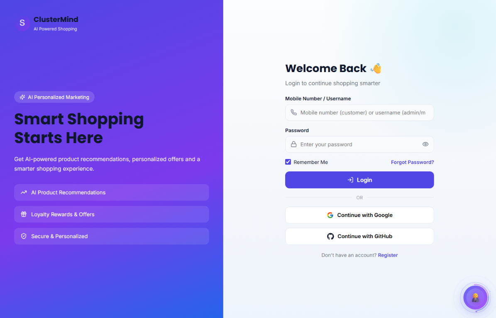
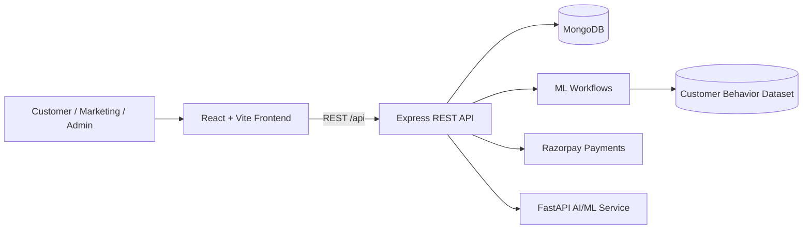

<p align="center">
  
</p>

<h1 align="center">ClusterMind</h1>

<p align="center">
  <strong>AI-powered customer intelligence and personalized marketing platform</strong>
</p>

<p align="center">
  <a href="#features">Features</a>
  &nbsp;|&nbsp;
  <a href="#tech-stack">Tech Stack</a>
  &nbsp;|&nbsp;
  <a href="#getting-started">Getting Started</a>
  &nbsp;|&nbsp;
  <a href="#api-overview">API</a>
</p>

<p align="center">
  
  
  
  
  
  
  
</p>

---

## Overview

**ClusterMind** is a full-stack e-commerce and customer intelligence platform. It combines a customer shopping experience with AI-assisted recommendations, customer segmentation, personalized offers, loyalty features, and a marketing administration suite.

The application is organized as three cooperating services:

- A **React + Vite** frontend for customers, marketing teams, and administrators.
- An **Express + MongoDB** REST API for commerce, authentication, payments, reporting, and ML workflows.
- A **FastAPI** service for AI/ML health checks and model-serving workflows.

---

## Screenshots

<p align="center">
  
</p>

<p align="center"><em>ClusterMind authentication screen</em></p>

---

## Features

### Customer experience

- Browse products with category navigation, search, filters, and product details.
- Product reviews, ratings, wishlist, cart, checkout, and order history.
- Customer profiles, saved addresses, notifications, and loyalty rewards.
- Personalized product recommendations and offers.
- Returns, cancellations, payments, and order tracking workflows.

### AI and personalization

- Customer behavior collection and analysis.
- Customer segmentation using the bundled K-Means model.
- Satisfaction and segment prediction using the bundled Random Forest model.
- Personalized recommendation workflows.
- Dataset, model, prediction, and customer-segment management.
- AI sales and gift-assistance services.

### Marketing suite

- Marketing dashboard with KPIs, charts, and reports.
- Customer targeting and behavior analysis.
- Campaign, coupon, offer, and loyalty-program management.
- Recommendation controls and ML model monitoring.
- Marketing team and workspace management.

### Administration

- Customer, product, order, review, coupon, and campaign management.
- Customer segments, recommendations, feedback, and notifications.
- Activity logs, roles, settings, and operational reports.

### Security and engineering

- JWT-based authentication and role-aware access control.
- Password hashing with bcrypt.
- MongoDB persistence through Mongoose models.
- Environment-based configuration with `.env.example` templates.
- Vercel deployment configuration for the application services.
- npm workspaces for frontend and backend development.

---

## Tech Stack

| Layer | Technologies |
| --- | --- |
| Frontend | React 18, Vite 6, React Router 6, Tailwind CSS 4, Framer Motion, Recharts, Axios, Lucide React |
| Backend | Node.js 22, Express 4, MongoDB, Mongoose, JWT, bcryptjs, Razorpay |
| AI / ML | Python, FastAPI, Uvicorn, K-Means and Random Forest model assets |
| Tooling | npm workspaces, ESLint, Vite build pipeline |
| Deployment | Vercel |

---

## Architecture



### Request flow

1. The frontend calls the backend through `/api`.
2. The backend authenticates requests and checks the user's role.
3. Commerce and customer data are stored in MongoDB through Mongoose models.
4. ML routes load customer datasets and model assets to provide segments, predictions, and recommendations.
5. Payment routes communicate with Razorpay using server-side configuration.

---

## Project Structure

```text
Cluster-Mind/
├── frontend/                 # React + Vite customer, marketing, and admin UI
│   ├── public/               # Logo, product images, and static assets
│   └── src/
│       ├── components/       # Reusable UI components
│       ├── context/          # Shared application state
│       ├── css/              # Theme and design styles
│       ├── layouts/          # Customer, marketing, and admin layouts
│       ├── pages/            # Application pages
│       ├── routes/           # Route definitions
│       ├── services/         # API clients and service helpers
│       └── utils/            # Shared utilities
├── backend/                  # Express + MongoDB REST API
│   ├── data/                 # Seed data and bundled ML dataset
│   ├── middleware/           # Authentication middleware
│   ├── models/               # Mongoose schemas
│   ├── routes/               # API route modules
│   ├── services/             # Business and AI sales services
│   ├── index.js              # API entry point
│   └── seed.js               # Database seeding
├── ai-ml/                    # FastAPI AI/ML service
│   ├── data/                 # Customer behavior datasets
│   ├── models/               # Trained model assets
│   └── main.py               # FastAPI application
├── docs/                     # Documentation assets and screenshots
├── package.json              # Workspace scripts
└── README.md
```

---

## Requirements

- Node.js 22.x
- npm
- Python 3.10 or newer
- MongoDB, locally or through MongoDB Atlas

---

## Getting Started

### 1. Install JavaScript dependencies

From the repository root:

```bash
npm install
```

### 2. Configure environment variables

Create local environment files from the provided templates:

```bash
cp backend/.env.example backend/.env
cp frontend/.env.example frontend/.env
cp ai-ml/.env.example ai-ml/.env
```

On Windows PowerShell:

```powershell
Copy-Item backend/.env.example backend/.env
Copy-Item frontend/.env.example frontend/.env
Copy-Item ai-ml/.env.example ai-ml/.env
```

Configure the backend MongoDB connection in `backend/.env`:

```env
PORT=4000
MONGODB_URI=mongodb://127.0.0.1:27017/shopsmart_db
```

The frontend uses `/api` by default. When the backend is hosted separately, set the API origin in `frontend/.env`:

```env
VITE_API_URL=http://localhost:4000
```

Never commit local `.env` files or payment credentials.

### 3. Install Python dependencies

```bash
python -m venv .venv
pip install -r ai-ml/requirements.txt
```

On Windows PowerShell, activate the environment with:

```powershell
.\.venv\Scripts\Activate.ps1
```

### 4. Seed development data

```bash
npm run seed
```

### 5. Start the services

Run each command in a separate terminal:

```bash
# Backend API - http://localhost:4000
npm run dev:backend

# Frontend - Vite prints the local URL, normally http://localhost:5173
npm run dev:frontend

# FastAPI ML service - http://localhost:8000
npm run dev:ml
```

---

## Available Scripts

| Command | Description |
| --- | --- |
| `npm run dev:frontend` | Start the Vite frontend |
| `npm run dev:backend` | Start the backend with Node watch mode |
| `npm run dev:ml` | Start the FastAPI ML service with reload |
| `npm run build` | Create a production frontend build |
| `npm run seed` | Seed the backend database |
| `npm --workspace frontend run lint` | Run frontend ESLint checks |

---

## API Overview

The backend exposes REST routes for:

- Authentication and users
- Products and recommendations
- Cart, wishlist, orders, payments, and returns
- Reviews and feedback
- Loyalty, coupons, campaigns, and marketing
- Customer behavior and segments
- ML predictions, datasets, and model workflows

Health check:

```text
GET http://localhost:4000/api/health
```

---

## Deployment

The frontend, backend, and ML service each include Vercel configuration:

```bash
# Frontend
cd frontend
vercel --prod

# Backend
cd backend
vercel --prod

# AI/ML service
cd ai-ml
vercel --prod
```

Configure production environment variables in the corresponding Vercel project settings before deployment.

---

## Project Status

ClusterMind is a final-year project focused on bringing e-commerce, customer analytics, personalized marketing, and AI-assisted recommendations together in one platform.

## License

This project is maintained for educational and portfolio purposes.
